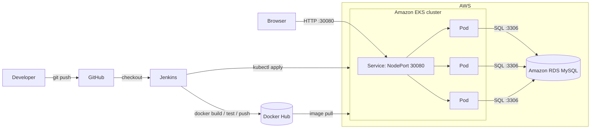

# Task Tracker: Three-Tier App with a DevOps Pipeline

A small task manager built as a **three-tier web application** and deployed with a fully automated **CI/CD pipeline**: GitHub → Jenkins → Docker Hub → Amazon EKS, with the database on Amazon RDS (MySQL).

This README focuses on **how the app is built, shipped and deployed**. For the application code itself, see [Application Overview](#application-overview).

---

## Table of Contents

1. [Architecture](#architecture)
2. [Tech Stack](#tech-stack)
3. [Repository Structure](#repository-structure)
4. [Application Overview](#application-overview)
5. [Configuration](#configuration)
6. [Run Locally](#run-locally)
7. [Containerization (Docker)](#containerization-docker)
8. [Kubernetes Manifests](#kubernetes-manifests)
9. [CI/CD Pipeline (Jenkins)](#cicd-pipeline-jenkins)
10. [AWS Infrastructure Setup](#aws-infrastructure-setup)
11. [Deploying](#deploying)
12. [Verifying the Deployment](#verifying-the-deployment)
13. [Troubleshooting](#troubleshooting)

---

## Architecture



| Tier | Responsibility | Where it runs |
|---|---|---|
| **1. Presentation** | Static HTML/CSS/JS served by Express | Inside the app container |
| **2. Application** | Express REST API, validation, business rules | Inside the app container (3 replicas on EKS) |
| **3. Data** | MySQL database, `tasks` table created automatically on startup | Amazon RDS |

## Tech Stack

| Area | Technology |
|---|---|
| Frontend | HTML, CSS, vanilla JavaScript |
| Backend | Node.js 22, Express 4 |
| Database | MySQL (Amazon RDS), accessed with `mysql2` |
| Containerization | Docker (`node:22-alpine`) |
| Registry | Docker Hub |
| CI/CD | Jenkins (declarative pipeline) |
| Orchestration | Kubernetes on Amazon EKS |
| Cloud | AWS (EKS, RDS, IAM, EC2) |

## Repository Structure

```
three-tier-app/
├── Dockerfile               # Container image definition
├── Jenkinsfile              # CI/CD pipeline
├── kubernetes/
│   ├── deployment.yaml      # App Deployment (3 replicas)
│   ├── service.yaml         # NodePort Service (30080 → 3000)
│   └── secrets.yaml         # DB credentials as a Kubernetes Secret
├── public/                  # Tier 1: UI (index.html, style.css, app.js)
├── server.js                # Tier 2: Express API
├── db.js                    # Tier 3: MySQL access layer
├── package.json
├── .env.example             # Template for local/test environment variables
├── kubectl.sha256           # Checksum for the kubectl binary
└── README.md
```

## Application Overview

REST API exposed by `server.js`:

| Method | Endpoint | Description |
|---|---|---|
| `GET` | `/api/tasks` | List all tasks |
| `POST` | `/api/tasks` | Create a task (`{ "title": "..." }`, max 140 chars) |
| `PATCH` | `/api/tasks/:id` | Toggle a task's done state |
| `DELETE` | `/api/tasks/:id` | Delete a task |
| `GET` | `/health` | Health check (returns `200 OK`) |

On startup the app runs `CREATE TABLE IF NOT EXISTS tasks ...`, so no manual schema setup is needed.

## Configuration

The app is configured entirely through environment variables (12-factor style).

| Variable | Description | Default |
|---|---|---|
| `DB_HOST` | MySQL / RDS endpoint | `localhost` |
| `DB_PORT` | MySQL port | `3306` |
| `DB_USER` | Database user | `root` |
| `DB_PASSWORD` | Database password | *(empty)* |
| `DB_NAME` | Database name | `task_tracker` |
| `PORT` | HTTP port the app listens on | `3000` |

Locally these come from a `.env` file; on Kubernetes they are injected from a Secret.

## Run Locally

**Prerequisites:** Node.js 18+ and a running MySQL/MariaDB instance (or an RDS endpoint you can reach).

```bash
git clone https://github.com/Sarthaki15/three-tier-app.git
cd three-tier-app

cp .env.example .env        # edit with your DB credentials
npm install
npm start
```

Open <http://localhost:3000>.

## Containerization (Docker)

```dockerfile
FROM node:22-alpine
WORKDIR /app
COPY . ./
RUN npm install
EXPOSE 3000
CMD ["node", "server.js"]
```

Build and run:

```bash
docker build -t <dockerhub-user>/three-tier-app:local .

docker run -d --name task-tracker \
  --env-file .env \
  -p 8080:3000 \
  <dockerhub-user>/three-tier-app:local

curl http://localhost:8080/health      # → OK
```

## Kubernetes Manifests

| File | Purpose |
|---|---|
| `kubernetes/secrets.yaml` | `Secret` named `three-tier-app-db-secrets` holding `DB_HOST`, `DB_PORT`, `DB_USER`, `DB_PASSWORD`, `DB_NAME` |
| `kubernetes/deployment.yaml` | `Deployment` with **3 replicas** of the app image, container port `3000`, env loaded from the Secret |
| `kubernetes/service.yaml` | `Service` of type **NodePort**: `8080 → 3000`, exposed on node port **30080** |


## CI/CD Pipeline (Jenkins)

The `Jenkinsfile` defines a declarative pipeline with these stages:

| # | Stage | What it does |
|---|---|---|
| 1 | **Git Checkout** | Clones the `main` branch from GitHub |
| 2 | **Build Docker Image** | Builds the image and tags it `:<BUILD_NUMBER>` and `:latest` |
| 3 | **Test Docker Image** | Starts the container with the `app-env-file` credential, waits, then runs `curl --fail` against `http://localhost:8080/`. The test container is always removed afterwards |
| 4 | **Docker Hub Login** | Logs in using the `docker-login` credential |
| 5 | **Push Docker Image** | Pushes both tags to Docker Hub |
| 6 | **Deploy to EKS** | Configures `kubeconfig` for the cluster and applies the Secret, Deployment and Service |
| 7 | **Verify Kubernetes Deployment** | Prints nodes, deployments, pods and services |

**Pipeline environment variables**

| Variable | Value |
|---|---|
| `DOCKERHUB_REPO` | `sarthakiparad2230/three-tier-app` |
| `EKS_CLUSTER_NAME` | `CD-Cluster` |

**Jenkins credentials required**

| Credential ID | Type | Contents |
|---|---|---|
| `app-env-file` | Secret file | A `.env`-format file used to run the test container (must point to a reachable DB) |
| `docker-login` | Username with password | Docker Hub username + access token |
| `aws_access_key` | AWS credentials | Access key / secret for an IAM user allowed to call EKS |

**Jenkins agent requirements:** Docker, AWS CLI v2, `kubectl`, `curl`, and permission for the `jenkins` user to run Docker (`usermod -aG docker jenkins`).

## AWS Infrastructure Setup

### 1. RDS (database tier)

1. Create an **RDS instance** with the **MySQL** engine.
2. Create the database named in `DB_NAME` (`task_tracker`), or set the initial database name during creation.
3. Place it in the same VPC as the EKS cluster.
4. **Security group:** allow inbound **TCP 3306** only from the EKS node / cluster security group, never from `0.0.0.0/0`.
5. Note the endpoint, e.g. `<name>.<id>.<region>.rds.amazonaws.com`.

### 2. EKS (application tier)

1. Create an EKS cluster named **`CD-Cluster`** (or change `EKS_CLUSTER_NAME` in the `Jenkinsfile`) with a managed node group.
2. Create an IAM user for Jenkins and grant it access to the cluster (IAM policy for `eks:DescribeCluster`, plus an EKS access entry or `aws-auth` mapping giving it Kubernetes permissions).
3. Open the node security group for **TCP 30080** from the sources that should reach the app.

### 3. Jenkins server

1. Launch an EC2 instance, install Jenkins, Docker, AWS CLI and `kubectl`.
2. Install the suggested plugins plus **Pipeline**, **Credentials Binding**, and **AWS Credentials**.
3. Add the three credentials listed [above](#cicd-pipeline-jenkins).
4. Set the default AWS region for the Jenkins user (`aws configure set region <region>`), because the pipeline's `aws eks update-kubeconfig` call doesn't pass `--region`.
5. Create a **Pipeline** job using "Pipeline script from SCM" pointing to this repo, or paste the `Jenkinsfile`.

## Deploying

### Automated (recommended)

1. Push changes to `main`.
2. Trigger the Jenkins job (manually, or configure a GitHub webhook / poll SCM).
3. Watch the stages complete in the Jenkins console.

### Manual deployment (without Jenkins)

```bash
# 1. Point kubectl at the cluster
aws eks update-kubeconfig --name CD-Cluster --region <region>

# 2. Apply manifests
kubectl apply -f kubernetes/secrets.yaml
kubectl apply -f kubernetes/deployment.yaml
kubectl apply -f kubernetes/service.yaml

# 3. Watch the rollout
kubectl rollout status deployment/three-tier-app-deployment
```

## Verifying the Deployment

```bash
kubectl get nodes
kubectl get deployment
kubectl get pods -o wide
kubectl get svc three-tier-app-service

# Logs
kubectl logs deploy/three-tier-app-deployment

# Health check from a node's public IP
curl http://<node-public-ip>:30080/health
```

Then open `http://<node-public-ip>:30080` in your browser.

## Troubleshooting

| Symptom | Likely cause / fix |
|---|---|
| `kubectl apply` fails with validation errors | Validate the manifests first with `kubectl apply --dry-run=client -f kubernetes/` and check YAML indentation |
| Pods in `CrashLoopBackOff` with `Failed to initialize database schema` | App can't reach RDS. Check `DB_*` values, RDS security group (3306 from EKS nodes), and that the `task_tracker` database exists |
| Pods in `ImagePullBackOff` | Image name/tag doesn't exist on Docker Hub, or the repo is private and no `imagePullSecret` is configured |
| `Unable to locate credentials` or `You must be logged in` in Jenkins | Check the `aws_access_key` credential and the IAM user's EKS access mapping |
| `aws eks update-kubeconfig` says cluster not found | Default AWS region isn't set for the Jenkins user |
| Jenkins `docker: permission denied` | Add `jenkins` to the `docker` group and restart Jenkins |
| Can't reach `:30080` | Open the port in the node security group; use a node's **public** IP |
| Test stage fails on `curl` | Test container can't connect to the DB with the `app-env-file` values, so check `docker logs test-app` output in the console |

---

## License

Add a license of your choice (e.g., MIT).
